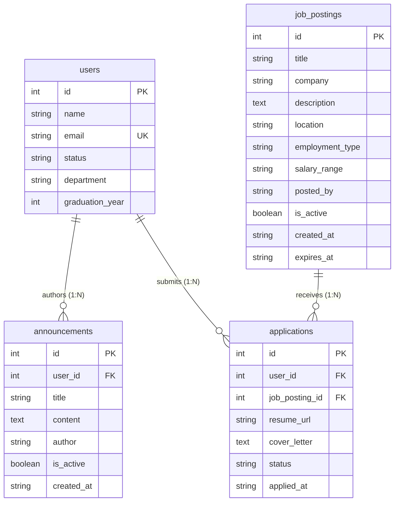

# Data Dictionary — Alumni Platform

This document describes the data models, field definitions, form mappings, and CRUD endpoint reference for the Alumni Platform API.

> See also: [README.md](README.md) — project overview, architecture, and getting started guide.

---

## Database Schema & Entity Relationships

This section provides a bird's-eye view of all tables in the Alumni Platform, their primary keys, foreign keys, and cardinalities.

> **Architecture Note:** `users` ve `job_postings` tabloları arasında **doğrudan yabancı anahtar (FK) bağlantısı yoktur**. `applications` tablosu, aday (`users`) ile iş ilanı (`job_postings`) arasındaki **Eylem Tablosu (Action / Junction Table)** olarak görev yapar ve Çoktan-Çoğa (Many-to-Many) ilişkiyi kurar.

### Entity-Relationship Diagram

```
┌──────────────────────────────────────┐             ┌──────────────────────────────────┐
│                users                 │             │           job_postings           │
├──────────────────────────────────────┤             ├──────────────────────────────────┤
│ PK  id               Integer         │             │ PK  id               Integer     │
│     name             String(120)     │             │     title            String(200) │
│ UQ  email            String(120)     │             │     company          String(150) │
│     status           String(20)      │             │     description      Text        │
│     department       String(120)     │             │     location         String(150) │
│     graduation_year  Integer         │             │     employment_type  String(50)  │
└──────────────────────────────────────┘             │     salary_range     String(100) │
         │ 1                     │ 1                 │     posted_by        String(100) │
         │                       │                   │     is_active        Boolean     │
         │ N (user_id)           │ N (user_id)       │     created_at       String(30)  │
         ▼                       ▼                   │     expires_at       String(50)  │
┌──────────────────┐    ┌──────────────────────────────────┐ └──────────────────────────────────┘
│  announcements   │    │          applications            │                   │ 1
├──────────────────┤    │          (Action Table)          │                   │
│ PK id  Integer   │    ├──────────────────────────────────┤                   │ N (job_posting_id)
│ FK user_id (opt) │    │ PK id              Integer       │◀──────────────────┘
│    title         │    │ FK user_id (req)   Integer (FK)  │
│    content       │    │ FK job_posting_id  Integer (FK)  │
│    author        │    │    resume_url      String(255)   │
│    is_active     │    │    cover_letter    Text          │
│    created_at    │    │    status          String(50)    │
└──────────────────┘    │    applied_at      String(30)    │
                        └──────────────────────────────────┘
```



### Master Relationship Matrix

| # | Kaynak Tablo (Source) | Kaynak Kolon (FK) | Hedef Tablo (Target) | Hedef Kolon (PK) | İlişki Türü (Cardinality) | İş Mantığı / Açıklama |
|---|---|---|---|---|---|---|
| 1 | `announcements` | `user_id` | `users` | `id` | Many-to-One (`N:1`) | Bir duyuruyu bir kullanıcı (yazar) yayınlar. Opsiyoneldir (`nullable=True`). |
| 2 | `applications` | `user_id` | `users` | `id` | Many-to-One (`N:1`) | Her iş başvurusunu kayıtlı bir kullanıcı (öğrenci/mezun) yapar. Zorunludur (`nullable=False`). |
| 3 | `applications` | `job_posting_id` | `job_postings` | `id` | Many-to-One (`N:1`) | Her iş başvurusu belirli bir iş ilanına yöneliktir. Zorunludur (`nullable=False`). |
| 4 | `users` | `id` | `announcements` | `user_id` | One-to-Many (`1:N`) | Bir kullanıcının yayınladığı birden fazla duyuru bulunabilir (`user.announcements`). |
| 5 | `users` | `id` | `applications` | `user_id` | One-to-Many (`1:N`) | Bir kullanıcının yaptığı birden fazla iş başvurusu bulunabilir (`user.applications`). |
| 6 | `job_postings` | `id` | `applications` | `job_posting_id` | One-to-Many (`1:N`) | Bir iş ilanına birden fazla başvuru gelebilir (`job_posting.applications`). |
| **Action** | `applications` | `(user_id, job_posting_id)` | `users` & `job_postings` | `id` | **Action / Junction Table** | `users` ile `job_postings` arasında doğrudan FK yoktur. `applications` tablosu aralarındaki bağlantıyı sağlayan eylem tablosudur. |

### Tables Summary

| Tablo Adı | Model Sınıfı | Dosya | Primary Key | Foreign Keys | Toplam Alan | Açıklama |
|---|---|---|---|---|---|---|
| `users` | `User` | `app/models/user.py` | `id` | — | 6 | Mezun ve öğrenci kullanıcı profilleri |
| `announcements` | `Announcement` | `app/models/announcement.py` | `id` | `user_id → users.id` | 7 | Etkinlik ve genel duyurular |
| `job_postings` | `JobPosting` | `app/models/job_posting.py` | `id` | — | 10 | İş ve staj fırsat ilanları (bağımsız) |
| `applications` | `Application` | `app/models/application.py` | `id` | `user_id → users.id`<br>`job_posting_id → job_postings.id` | 7 | Eylem tablosu: Kullanıcıların iş ilanlarına başvuruları |

---

## User

**Model file:** [`app/models/user.py`](app/models/user.py)  
**Storage:** Database via SQLAlchemy & Flask-Migrate (PostgreSQL in Docker / SQLite fallback)  
**Controllers:** `UserController` (HTML) · `ApiUserController` (JSON API)

### Field Definitions

| Field | Python Type | Form Field (`name=`) | Required | Default | Notes |
|---|---|---|---|---|---|
| `id` | `int` | — | — | Auto-increment | Assigned by the model on create; not sent in form |
| `name` | `str` | `name` | Yes | — | Full name of the user |
| `email` | `str` | `email` | Yes | — | Must be unique per user |
| `status` | `str` | `status` | Yes | `"student"` | Accepted values: `alumni`, `student` |
| `department` | `str` | `department` | No | `None` | Academic department (e.g. Computer Engineering) |
| `graduation_year` | `int` | `graduation_year` | No | `None` | Only stored when `status = alumni`; ignored for students |

### Relationships

| Relationship | Type | Target Model | Foreign Key | Notes |
|---|---|---|---|---|
| `announcements` | One-to-Many | `Announcement` | `announcements.user_id → users.id` | A user can author many announcements |
| `applications` | One-to-Many | `Application` | `applications.user_id → users.id` | A user can submit many job applications (Action Table) |

### Business Rules

- `graduation_year` is automatically set to `None` if `status` is `"student"` — even if a value is submitted.
- `name` and `email` are validated as required on both `POST` (create) and `PUT` (full update).
- `id` is never accepted from the client; it is always assigned server-side.

---

### CRUD Operations

#### Web Interface (HTML)

| Operation | Method | URL | Controller Method | View Template |
|---|---|---|---|---|
| List all users | `GET` | `/users/` | `UserController.index()` | `user/index.html` |
| Show create form | `GET` | `/users/new` | — | `user/create.html` |
| Create user | `POST` | `/users/` | `UserController.create(data)` | Redirects to list on success |
| Show edit form | `GET` | `/users/<id>/edit` | `UserController.show(id)` | `user/edit.html` |
| Update user | `POST` | `/users/<id>/edit` | `UserController.update(id, data)` | Redirects to list on success |
| Delete user | `POST` | `/users/<id>/delete` | `UserController.delete(id)` | Redirects to list on success |

#### REST API (JSON)

| Operation | Method | URL | Controller Method | Success Code |
|---|---|---|---|---|
| List all users | `GET` | `/api/users/` | `ApiUserController.index()` | `200 OK` |
| Get user by ID | `GET` | `/api/users/<id>` | `ApiUserController.show(id)` | `200 OK` |
| Create user | `POST` | `/api/users/` | `ApiUserController.create()` | `201 Created` |
| Full update | `PUT` | `/api/users/<id>` | `ApiUserController.update(id)` | `200 OK` |
| Partial update | `PATCH` | `/api/users/<id>` | `ApiUserController.partial_update(id)` | `200 OK` |
| Delete user | `DELETE` | `/api/users/<id>` | `ApiUserController.delete(id)` | `200 OK` |

#### Nested Endpoints (under User)

| Operation | Method | URL | Description | Success Code |
|---|---|---|---|---|
| List user's announcements | `GET` | `/api/users/<user_id>/announcements` | Returns all announcements authored by this user | `200 OK` |
| Create user's announcement | `POST` | `/api/users/<user_id>/announcements` | Creates an announcement associated with this user | `201 Created` |
| List user's applications | `GET` | `/api/users/<user_id>/applications` | Returns all job applications submitted by this user | `200 OK` |
| Create user's application | `POST` | `/api/users/<user_id>/applications` | Submits a new job application as this user | `201 Created` |

#### API Error Responses

| Status Code | Condition |
|---|---|
| `400 Bad Request` | Missing required field (`name` or `email`) |
| `404 Not Found` | No user found with the given `id` |

---

### Postman — Form-Data Examples

**POST /api/users/** — Create a student

| Key | Value |
|---|---|
| `name` | Berru |
| `email` | berru@example.com |
| `status` | student |
| `department` | Computer Engineering |

**POST /api/users/** — Create an alumni

| Key | Value |
|---|---|
| `name` | Ali Yılmaz |
| `email` | ali@example.com |
| `status` | alumni |
| `department` | Business Administration |
| `graduation_year` | 2022 |

**PATCH /api/users/1** — Partial update (only email)

| Key | Value |
|---|---|
| `email` | newemail@example.com |

**PUT /api/users/1** — Full replace (all fields required)

| Key | Value |
|---|---|
| `name` | Berru Updated |
| `email` | berru2@example.com |
| `status` | alumni |
| `department` | Computer Engineering |
| `graduation_year` | 2025 |

---

## Announcement

**Model file:** [`app/models/announcement.py`](app/models/announcement.py)  
**Storage:** Database via SQLAlchemy & Flask-Migrate (PostgreSQL in Docker / SQLite fallback)  
**Controllers:** `AnnouncementController` (HTML) · `ApiAnnouncementController` (JSON API)

### Field Definitions

| Field | Python Type | Form Field (`name=`) | Required | Default | Notes |
|---|---|---|---|---|---|
| `id` | `int` | — | — | Auto-increment | Assigned by the model on create |
| `title` | `str` | `title` | Yes | — | Short headline for the announcement |
| `content` | `str` | `content` | Yes | — | Full body text of the announcement |
| `author` | `str` | `author` | No | `None` | Display name of the person posting |
| `is_active` | `bool` | `is_active` | No | `True` | Accepted form values: `true` / `false` |
| `created_at` | `str` | — | — | `datetime.now()` | Set automatically on creation; not editable |
| `user_id` | `int` | `user_id` | No | `None` | FK → `users.id`; links announcement to the author user |

### Relationships

| Relationship | Type | Target Model | Foreign Key | Notes |
|---|---|---|---|---|
| `user` | Many-to-One | `User` | `announcements.user_id → users.id` | The user who created this announcement |

### Business Rules

- `title` and `content` are required on both create and full update.
- `is_active` accepts the string values `"true"` / `"false"` from form-data; these are converted to `bool` internally.
- `created_at` is set once at creation time and never modified.

---

### CRUD Operations

#### Web Interface (HTML)

| Operation | Method | URL | Controller Method | View Template |
|---|---|---|---|---|
| List all | `GET` | `/announcements/` | `AnnouncementController.index()` | `announcement/index.html` |
| Show create form | `GET` | `/announcements/new` | — | `announcement/create.html` |
| Create | `POST` | `/announcements/` | `AnnouncementController.create(data)` | Redirects to list on success |
| Show edit form | `GET` | `/announcements/<id>/edit` | `AnnouncementController.show(id)` | `announcement/edit.html` |
| Update | `POST` | `/announcements/<id>/edit` | `AnnouncementController.update(id, data)` | Redirects to list on success |
| Delete | `POST` | `/announcements/<id>/delete` | `AnnouncementController.delete(id)` | Redirects to list on success |

#### REST API (JSON)

| Operation | Method | URL | Controller Method | Success Code |
|---|---|---|---|---|
| List all | `GET` | `/api/announcements/` | `ApiAnnouncementController.index()` | `200 OK` |
| Get by ID | `GET` | `/api/announcements/<id>` | `ApiAnnouncementController.show(id)` | `200 OK` |
| Create | `POST` | `/api/announcements/` | `ApiAnnouncementController.create()` | `201 Created` |
| Full update | `PUT` | `/api/announcements/<id>` | `ApiAnnouncementController.update(id)` | `200 OK` |
| Partial update | `PATCH` | `/api/announcements/<id>` | `ApiAnnouncementController.partial_update(id)` | `200 OK` |
| Delete | `DELETE` | `/api/announcements/<id>` | `ApiAnnouncementController.delete(id)` | `200 OK` |

#### API Error Responses

| Status Code | Condition |
|---|---|
| `400 Bad Request` | Missing `title` or `content` |
| `404 Not Found` | No announcement found with the given `id` |

---

### Postman — Form-Data Examples

**POST /api/announcements/** — Create an active announcement

| Key | Value |
|---|---|
| `title` | Spring Career Fair 2025 |
| `content` | Join us on April 10th for the annual career fair at the main campus. |
| `author` | Admin |
| `is_active` | true |

**PATCH /api/announcements/1** — Deactivate an announcement

| Key | Value |
|---|---|
| `is_active` | false |

---

## JobPosting

**Model file:** [`app/models/job_posting.py`](app/models/job_posting.py)  
**Storage:** Database via SQLAlchemy & Flask-Migrate (PostgreSQL in Docker / SQLite fallback)  
**Controllers:** `JobPostingController` (HTML) · `ApiJobPostingController` (JSON API)

### Field Definitions

| Field | Python Type | DB Type | Form Field (`name=`) | Required | Default | Notes |
|---|---|---|---|---|---|---|
| `id` | `int` | `Integer` PK | — | — | Auto-increment | Assigned by the model on create; not sent in form |
| `title` | `str` | `String(200)` | `title` | Yes | — | Job position title (e.g. "Backend Developer") |
| `description` | `str` | `Text` | `description` | Yes | — | Full job description, responsibilities, requirements |
| `company` | `str` | `String(150)` | `company` | Yes | — | Hiring company / organization name |
| `location` | `str` | `String(150)` | `location` | No | `None` | Work location (e.g. "Istanbul", "Remote") |
| `employment_type` | `str` | `String(50)` | `employment_type` | No | `"full-time"` | Accepted: `full-time`, `part-time`, `internship`, `contract`, `remote` |
| `salary_range` | `str` | `String(100)` | `salary_range` | No | `None` | Free-text salary info (e.g. "15.000-25.000 TL") |
| `posted_by` | `str` | `String(100)` | `posted_by` | No | `None` | Name or email of the person who posted the job |
| `is_active` | `bool` | `Boolean` | `is_active` | No | `True` | Accepted form values: `true` / `false` |
| `created_at` | `str` | `DateTime` | — | — | `datetime.now()` | Set automatically on creation; not editable |
| `expires_at` | `str` | `String(50)` | `expires_at` | No | `None` | Expiration date (e.g. "2025-12-31"); informational only |

### Relationships

| Relationship | Type | Target Model | Foreign Key | Notes |
|---|---|---|---|---|
| `applications` | One-to-Many | `Application` | `applications.job_posting_id → job_postings.id` | Candidates who applied to this job posting (Action Table) |

### Business Rules

- `title`, `description`, and `company` are required on both `POST` (create) and `PUT` (full update).
- `employment_type` defaults to `"full-time"` if not provided.
- `is_active` accepts the string values `"true"` / `"false"` from form-data; these are converted to `bool` internally.
- `created_at` is set once at creation time and never modified.
- `expires_at` is informational; no automatic deactivation is performed when the date passes.
- `id` is never accepted from the client; it is always assigned server-side.

---

### CRUD Operations

#### Web Interface (HTML)

| Operation | Method | URL | Controller Method | View Template |
|---|---|---|---|---|
| List all | `GET` | `/job-postings/` | `JobPostingController.index()` | `job_posting/index.html` |
| Show create form | `GET` | `/job-postings/new` | — | `job_posting/create.html` |
| Create | `POST` | `/job-postings/` | `JobPostingController.create(data)` | Redirects to list on success |
| Show edit form | `GET` | `/job-postings/<id>/edit` | `JobPostingController.show(id)` | `job_posting/edit.html` |
| Update | `POST` | `/job-postings/<id>/edit` | `JobPostingController.update(id, data)` | Redirects to list on success |
| Delete | `POST` | `/job-postings/<id>/delete` | `JobPostingController.delete(id)` | Redirects to list on success |

#### REST API (JSON)

| Operation | Method | URL | Controller Method | Success Code |
|---|---|---|---|---|
| List all | `GET` | `/api/job-postings/` | `ApiJobPostingController.index()` | `200 OK` |
| Get by ID | `GET` | `/api/job-postings/<id>` | `ApiJobPostingController.show(id)` | `200 OK` |
| Create | `POST` | `/api/job-postings/` | `ApiJobPostingController.create()` | `201 Created` |
| Full update | `PUT` | `/api/job-postings/<id>` | `ApiJobPostingController.update(id)` | `200 OK` |
| Partial update | `PATCH` | `/api/job-postings/<id>` | `ApiJobPostingController.partial_update(id)` | `200 OK` |
| Delete | `DELETE` | `/api/job-postings/<id>` | `ApiJobPostingController.delete(id)` | `200 OK` |

#### Nested Endpoints (under JobPosting)

| Operation | Method | URL | Description | Success Code |
|---|---|---|---|---|
| List job's applications | `GET` | `/api/job-postings/<job_id>/applications` | Returns all applications submitted for this job | `200 OK` |
| Apply to job posting | `POST` | `/api/job-postings/<job_id>/applications` | Submits an application for this specific job | `201 Created` |

#### API Error Responses

| Status Code | Condition |
|---|---|
| `400 Bad Request` | Missing `title`, `description`, or `company` |
| `404 Not Found` | No job posting found with the given `id` |

---

### Postman — Form-Data Examples

**POST /api/job-postings/** — Create a full-time job posting

| Key | Value |
|---|---|
| `title` | Backend Developer |
| `description` | We are looking for a Python/Flask backend developer with 2+ years of experience. |
| `company` | TechCorp Istanbul |
| `location` | Istanbul |
| `employment_type` | full-time |
| `salary_range` | 25.000-40.000 TL |
| `posted_by` | hr@techcorp.com |
| `is_active` | true |
| `expires_at` | 2025-12-31 |

**POST /api/job-postings/** — Create an internship posting

| Key | Value |
|---|---|
| `title` | Summer Internship — Data Analyst |
| `description` | 3-month summer internship for students in their 3rd or 4th year. |
| `company` | DataWorks |
| `location` | Remote |
| `employment_type` | internship |
| `posted_by` | careers@dataworks.com |

**PATCH /api/job-postings/1** — Deactivate a job posting

| Key | Value |
|---|---|
| `is_active` | false |

**PUT /api/job-postings/1** — Full replace (all required fields)

| Key | Value |
|---|---|
| `title` | Senior Backend Developer |
| `description` | Updated: Now seeking a senior-level developer with 5+ years of experience. |
| `company` | TechCorp Istanbul |
| `location` | Istanbul / Hybrid |
| `employment_type` | full-time |
| `salary_range` | 40.000-60.000 TL |
| `posted_by` | hr@techcorp.com |
| `is_active` | true |
| `expires_at` | 2026-03-31 |

---

## Application

**Model file:** [`app/models/application.py`](app/models/application.py)  
**Storage:** Database via SQLAlchemy & Flask-Migrate (PostgreSQL in Docker / SQLite fallback)  
**Controllers:** `ApplicationController` (HTML) · `ApiApplicationController` (JSON API)

> **Action Table Role:** `Application` tablosu `User` ve `JobPosting` modelleri arasındaki **Eylem Tablosudur (Action / Junction Table)**. `users` ile `job_postings` arasında doğrudan FK ilişkisi bulunmaz; kullanıcıların ilanlarla etkileşimi (başvuru yapma) bu tablo üzerinden yürütülür.

### Field Definitions

| Field | Python Type | DB Type | Form Field (`name=`) | Required | Default | Notes |
|---|---|---|---|---|---|---|
| `id` | `int` | `Integer` PK | — | — | Auto-increment | Assigned by the model on create; not sent in form |
| `user_id` | `int` | `Integer` FK | `user_id` | Yes | — | FK → `users.id`; links application to the applicant user |
| `job_posting_id` | `int` | `Integer` FK | `job_posting_id` | Yes | — | FK → `job_postings.id`; links application to the job posting |
| `resume_url` | `str` | `String(255)` | `resume_url` | No | `None` | Link to CV, LinkedIn, or portfolio |
| `cover_letter` | `str` | `Text` | `cover_letter` | No | `None` | Candidate's message / statement of interest |
| `status` | `str` | `String(50)` | `status` | No | `"pending"` | Accepted: `pending`, `reviewed`, `accepted`, `rejected` |
| `applied_at` | `str` | `String(30)` | — | — | `datetime.now()` | Set automatically on application creation; not editable |

### Relationships

| Relationship | Type | Target Model | Foreign Key | Notes |
|---|---|---|---|---|
| `user` | Many-to-One | `User` | `applications.user_id → users.id` | The applicant user |
| `job_posting` | Many-to-One | `JobPosting` | `applications.job_posting_id → job_postings.id` | The target job posting |

### Business Rules

- `user_id` and `job_posting_id` are required on both `POST` (create) and `PUT` (full update).
- Both `user_id` and `job_posting_id` must refer to existing records in the database.
- `status` defaults to `"pending"` if not provided; valid values: `pending`, `reviewed`, `accepted`, `rejected`.
- `applied_at` is set once at creation time and never modified.
- `id` is never accepted from the client; it is always assigned server-side.

---

### CRUD Operations

#### Web Interface (HTML)

| Operation | Method | URL | Controller Method | View Template |
|---|---|---|---|---|
| List all | `GET` | `/applications/` | `ApplicationController.index()` | `application/index.html` |
| Show create form | `GET` | `/applications/new` | — | `application/create.html` |
| Create | `POST` | `/applications/` | `ApplicationController.create(data)` | Redirects to list on success |
| Show edit form | `GET` | `/applications/<id>/edit` | `ApplicationController.show(id)` | `application/edit.html` |
| Update | `POST` | `/applications/<id>/edit` | `ApplicationController.update(id, data)` | Redirects to list on success |
| Delete | `POST` | `/applications/<id>/delete` | `ApplicationController.delete(id)` | Redirects to list on success |

#### REST API (JSON)

| Operation | Method | URL | Controller Method | Success Code |
|---|---|---|---|---|
| List all | `GET` | `/api/applications/` | `ApiApplicationController.index()` | `200 OK` |
| Get by ID | `GET` | `/api/applications/<id>` | `ApiApplicationController.show(id)` | `200 OK` |
| Create | `POST` | `/api/applications/` | `ApiApplicationController.create()` | `201 Created` |
| Full update | `PUT` | `/api/applications/<id>` | `ApiApplicationController.update(id)` | `200 OK` |
| Partial update | `PATCH` | `/api/applications/<id>` | `ApiApplicationController.partial_update(id)` | `200 OK` |
| Delete | `DELETE` | `/api/applications/<id>` | `ApiApplicationController.delete(id)` | `200 OK` |

#### API Error Responses

| Status Code | Condition |
|---|---|
| `400 Bad Request` | Missing `user_id` or `job_posting_id` |
| `404 Not Found` | No application found with the given `id`, or referenced `user`/`job_posting` not found |

---

### Postman — Form-Data Examples

**POST /api/applications/** — Submit a new job application

| Key | Value |
|---|---|
| `user_id` | 1 |
| `job_posting_id` | 1 |
| `resume_url` | https://linkedin.com/in/example |
| `cover_letter` | I have strong experience in Python and Flask backend architectures. |
| `status` | pending |

**PATCH /api/applications/1** — Update application status

| Key | Value |
|---|---|
| `status` | reviewed |

**PUT /api/applications/1** — Full replace

| Key | Value |
|---|---|
| `user_id` | 1 |
| `job_posting_id` | 1 |
| `resume_url` | https://github.com/example/cv.pdf |
| `cover_letter` | Updated cover letter with additional project details. |
| `status` | accepted |

---

## Swagger / OpenAPI

Interactive API documentation is available at:

```
http://localhost:5000/api/swagger
```

All `/api/users`, `/api/announcements`, `/api/job-postings`, and `/api/applications` endpoints are documented there with request parameters and response schemas.
